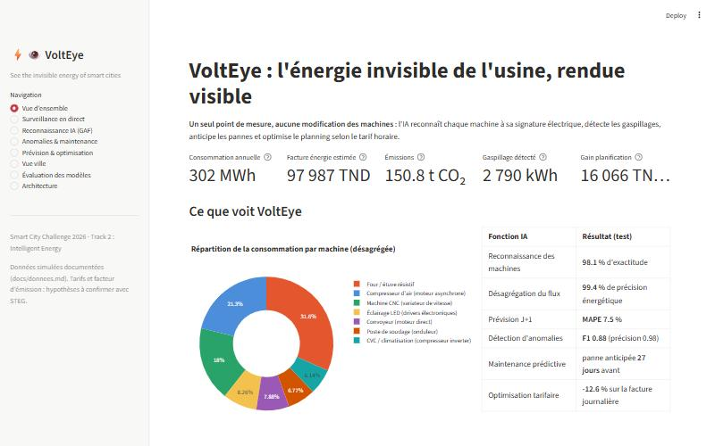
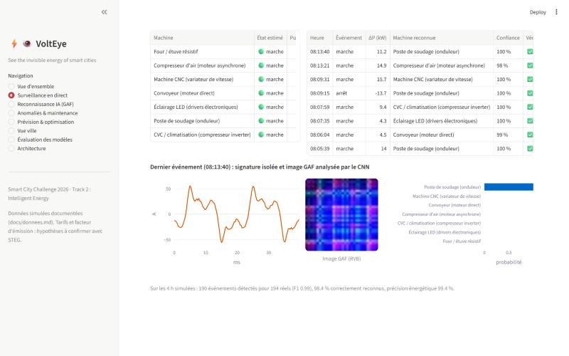

# ⚡👁️ VoltEye

**See the invisible energy of smart cities.**
*Un seul capteur. Toutes les machines. Des villes plus intelligentes.*

> Smart City Challenge 2026 · **Track 2 : Smart City for Intelligent Energy** · partenaire industriel : STEG

VoltEye est une plateforme d'**intelligence énergétique non intrusive** pour les sites industriels.
Un **point de mesure unique** à l'arrivée électrique d'un atelier suffit : l'IA reconnaît chaque machine
à sa **signature électrique** (forme d'onde et harmoniques), reconstitue sa consommation, détecte les
gaspillages, anticipe les pannes et optimise le planning selon le tarif horaire. Aucun capteur n'est posé
sur les machines, aucun arrêt de production n'est nécessaire.



---

## Le problème

Dans la plupart des usines, l'énergie n'est suivie qu'à travers la facture mensuelle. On ne voit ni la
machine laissée sous tension la nuit, ni la fuite d'air comprimé, ni le moteur qui se dégrade, ni la
cuisson lancée à l'heure de pointe. Poser un compteur sur chaque machine coûte cher, impose des arrêts
et des modifications d'équipements souvent certifiés. **Ce qui n'est pas mesuré n'est pas maîtrisé.**

## La solution

| Fonction | Méthode IA | Résultat sur données de test |
|---|---|---|
| **Reconnaître** les machines | Ondelettes + harmoniques → images GAF → CNN, fusionné avec une forêt aléatoire sur le spectre | **97,9 %** d'exactitude (7 types de machines) |
| **Désagréger** le signal unique | Détection d'événements + reconnaissance | **99,2 %** de précision énergétique, F1 détection 0,99 (0,96 en scénario dense) |
| **Prévoir** la consommation à J+1 | Gradient boosting (calendrier, météo, retards ≥ 24 h) | **MAPE 7,7 %** (baseline : 12,3 %) |
| **Détecter** les gaspillages | Consommation attendue réentraînée chaque mois + score robuste des résidus | **F1 0,82** sur 4 mois jamais vus, précision 0,87 (baseline z-score : F1 0,18) |
| **Anticiper** les pannes | Dérive de la distorsion harmonique (THD), score de santé | panne anticipée **27 jours** avant, 0 fausse alerte |
| **Optimiser** le planning | Programme linéaire en nombres entiers (HiGHS) sur le tarif horaire | **-12,6 %** sur la facture des jours ouvrés, -77 kW de pointe |
| **Effacer** la pointe du réseau (VoltEye Grid) | Prévision J+1 de 10 zones + programme linéaire de répartition des démarrages | **-10,3 MW** sur la pointe agrégée d'été (-10,9 %), -6,5 MW face à la réponse au tarif seul |

Toutes les métriques sont mesurées sur des données jamais vues à l'entraînement et comparées à des
baselines (voir [docs/resultats.md](docs/resultats.md) et la page « Évaluation » de l'application).

**Validé sur mesures industrielles réelles** (jeu public HIPE du KIT, une semaine au pas de 5 s) : 7 machines
reconnues à **99,9 %** à partir de leur signature harmonique, 82 % des événements retrouvés depuis
l'arrivée générale, prévision à 1 h meilleure que la persistance (MAPE 14,8 % contre 18,7 %), et 29 % de
l'énergie consommée hors production mise en évidence.

## Architecture

```
 Machines ─► point de mesure ─► capteur de puissance ─► passerelle edge ─► réseau ─► cloud ─► tableau de bord
 (charges)   unique              (courant, tension)     (Raspberry Pi 5)   NB-IoT/5G  (analyse)  (usine, ville, STEG)
```

Détails : [docs/architecture.md](docs/architecture.md).


## Installation et lancement

Prérequis : Python 3.10 à 3.12.

```bash
git clone https://github.com/ismaelsellmi/VoltEye-2.0.git volteye
cd volteye
python -m venv .venv
# Windows : .venv\Scripts\activate     Linux / macOS : source .venv/bin/activate
pip install torch --index-url https://download.pytorch.org/whl/cpu
pip install -r requirements.txt
```

Les modèles entraînés et les résultats sont fournis dans `artifacts/`. Pour lancer le tableau de bord :

```bash
streamlit run app/streamlit_app.py
```

Pour tout régénérer (données simulées, entraînement, évaluation, figures, environ 1 minute) :

```bash
python -m volteye.pipeline
```

Tests :

```bash
python -m pytest tests
```

### Plateforme complète (Docker)

Base TimescaleDB, broker MQTT, API, passerelle edge simulée et application web, en une commande :

```bash
docker compose up --build
```

- **Application VoltEye (PWA)** : http://localhost:8080, installable sur téléphone et ordinateur
- API et documentation interactive : http://localhost:8000/docs
- WebSocket du direct : `ws://localhost:8000/ws/direct`
- Rejeu d'une journée réelle de l'usine HIPE en plus : `docker compose --profile hipe up --build`

Développement de l'application web (rechargement à chaud, API sur le port 8000) :

```bash
cd web
npm install
npm run dev
```

La base est remplie automatiquement au premier démarrage à partir de `artifacts/`. Validation sur données
réelles : `python scripts/telecharger_hipe.py` puis `python -m volteye.pipeline`.

## Le tableau de bord

| Page | Contenu |
|---|---|
| Vue d'ensemble | Indicateurs clés, répartition par machine, alertes récentes |
| Surveillance en direct | Rejeu du flux capteur seconde par seconde, machines reconnues, image GAF de chaque événement |
| Reconnaissance IA (GAF) | Démonstration interactive : choisir une machine, une charge, un niveau de bruit et suivre la chaîne signal → image → décision |
| Anomalies & maintenance | Alertes expliquées avec coût (TND) et CO₂, score de santé des machines à une date choisie |
| Prévision & optimisation | Prévision J+1 contre réel, planning optimisé selon le tarif horaire |
| Vue ville (VoltEye Grid) | Pointe agrégée de 10 zones industrielles, effacement coordonné, carte |
| Évaluation des modèles | Toutes les métriques, baselines et matrices de confusion |



## Structure du dépôt

```
volteye/
├── volteye/                 code source
│   ├── config.py            paramètres (réseau 50 Hz, tarifs, facteur d'émission)
│   ├── signals.py           catalogue des machines, formes d'onde, mesures, séquences
│   ├── gaf.py               Gramian Angular Field
│   ├── recognition.py       reconnaissance (baselines, CNN GAF, fusion) et évaluation
│   ├── stream.py            flux temps réel et désagrégation par événements
│   ├── history.py           historique horaire d'un an avec anomalies étiquetées
│   ├── forecasting.py       prévision J+1
│   ├── anomaly.py           détection d'anomalies et maintenance prédictive
│   ├── optimization.py      optimisation du planning (PuLP / HiGHS)
│   ├── grid.py              VoltEye Grid : flexibilité multi-sites et pointe réseau
│   ├── hipe.py              validation sur données industrielles réelles (HIPE)
│   ├── figures.py           figures du rapport
│   └── pipeline.py          exécution de bout en bout
├── app/streamlit_app.py     tableau de bord
├── artifacts/               modèles entraînés, données et métriques
├── docs/                    architecture, données, résultats, figures, captures
├── tests/                   tests de cohérence
└── livrables/               rapport technique, pitch, script vidéo
```

## Données

Le règlement du challenge autorise les données simulées. VoltEye utilise un **simulateur physique**
documenté dans [docs/donnees.md](docs/donnees.md) : formes d'onde de 7 types de machines industrielles
(réseau 50 Hz, échantillonnage 3,2 kHz), un atelier en fonctionnement réel pendant 4 h à 1 mesure/s, et un
an d'historique horaire tenant compte des postes, du calendrier tunisien (jours fériés, Ramadan) et de la
température. Des anomalies réalistes sont injectées avec leur vérité terrain pour mesurer les modèles.
Le simulateur produit les mêmes grandeurs qu'un vrai capteur : il suffit de le remplacer par le flux du
capteur pour passer en conditions réelles.

**Hypothèses à confirmer** : tarif horaire industriel et facteur d'émission du réseau tunisien
(`volteye/config.py`), à remplacer par les valeurs officielles STEG / ANME.

## Limites et prochaines étapes

- Validation sur données réelles : un pilote de 4 semaines sur un atelier, avec quelques compteurs de référence.
- Machines identiques fonctionnant en parallèle : à distinguer par la localisation (plusieurs points de mesure) ou le contexte de production.
- Mesure triphasée réelle : capteur avec pinces ampèremétriques et échantillonnage ≥ 3,2 kHz pour les harmoniques.
- Pilotage automatique des charges (effacement aux heures de pointe en lien avec le distributeur).

## Références

- G. W. Hart, « Nonintrusive appliance load monitoring », *Proceedings of the IEEE*, 1992.
- Z. Wang, T. Oates, « Imaging time-series to improve classification and imputation », *IJCAI*, 2015 (Gramian Angular Field).
- F. T. Liu, K. M. Ting, Z.-H. Zhou, « Isolation Forest », *IEEE ICDM*, 2008.
- Q. Huangfu, J. A. J. Hall, « Parallelizing the dual revised simplex method », *Mathematical Programming Computation*, 2018 (solveur HiGHS).
- Chaîne ondelettes → GAF → CNN pour la reconnaissance de charges : inspirée de travaux publiés sur le NILM par images GAF (référence de l'article source de l'équipe à compléter).

## Équipe

Équipe VoltEye, Smart City Challenge 2026. *(Noms et rôles à compléter.)*
